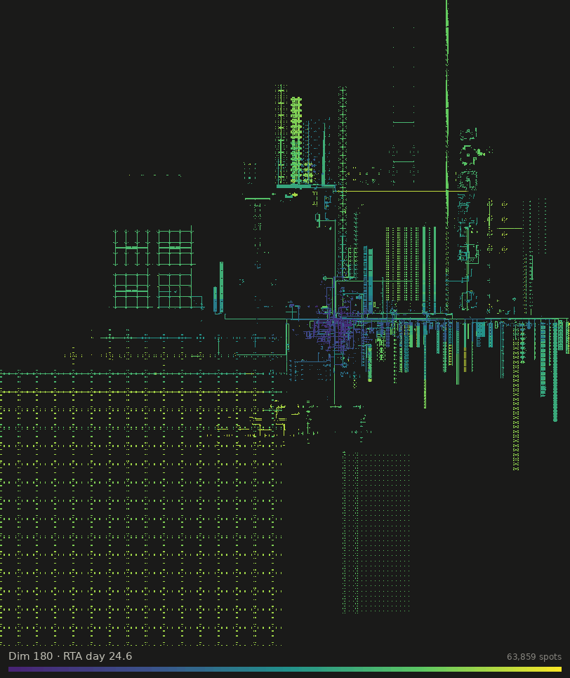

# GTNH Speedrun Audit



*Audit mod 0.5 logged these GT machine placements in the main base of the Stargate speedrun.*

The mod keeps a tamper-evident log of a [GT: New Horizons](https://gtnh.miraheze.org/) (GTNH) run, so a
speedrun.com moderator can check the run. When the run ends, `/audit export` writes one zip to submit.

The main cost is disk space. For a base with 100,000 item types in AE2, the log grows by about 420 MB over a
500-hour run.

## Setup

Download the jar from [Releases](https://github.com/OrderedSet86/gtnh-speedrun-audit/releases). The jar
works with GTNH 2.8.4, 2.9.0, 2.9.1 and 2.9.2.

- Multiplayer: put the jar in the server's `mods/`. Players don't need the jar.
- Singleplayer: put the jar in the instance's `mods/`.

Install the mod before you create the world. When you add the mod to an existing world, the log starts at
that point.

The log is in `speedrun-audit/` in the server folder, or in the instance folder in singleplayer. The folder is
outside the world folder. Keep the folder with the server, and don't edit, move or delete a file in the folder.

## Commands

```
/audit status     clocks and log health
/audit verify     check that the log is intact
/audit snapshot   take every snapshot and census now
/audit export     write the submission zip
```

`/audit` is an op command on a server, and works without cheats in singleplayer. `/audit export` writes the
zip to `speedrun-audit/<world-id>/export/`.

## Run clock

The run clock is IGT (in-game time). IGT counts the server ticks of all sessions, and starts when a player first walks, so
world generation and the spawn drop don't count. IGT stops while a singleplayer game is paused, runs while a
dedicated server is up with nobody online, and goes back when you restore a backup.

## Restores and copies

Restoring a backup is allowed, and so is playing on after a crash. The mod logs each restore. A copy of the
world in another folder, such as a practice copy, gets a separate log, and `/audit export` puts the log of
each copy in the zip.

## Other documents

- [VERIFIERS.md](VERIFIERS.md): the logged events, and how a moderator checks a submission.
- [INNOCENCE.md](INNOCENCE.md): events that look suspicious but have innocent causes.
- [docs/DEVELOPMENT.md](docs/DEVELOPMENT.md): the build, the self-test and the AE2 bench.
